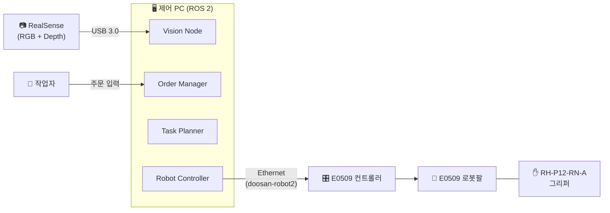
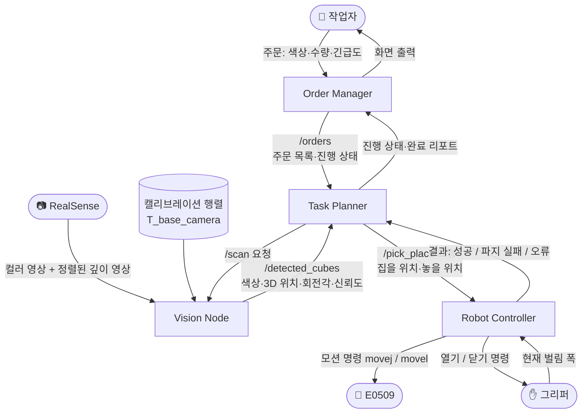
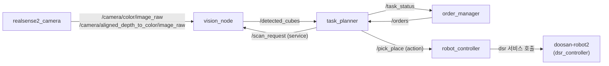
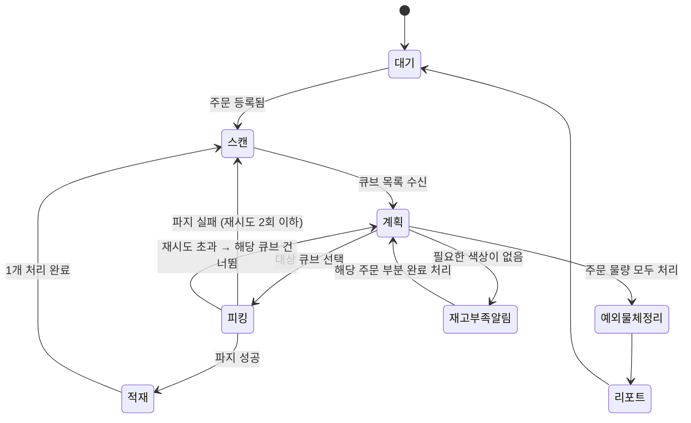
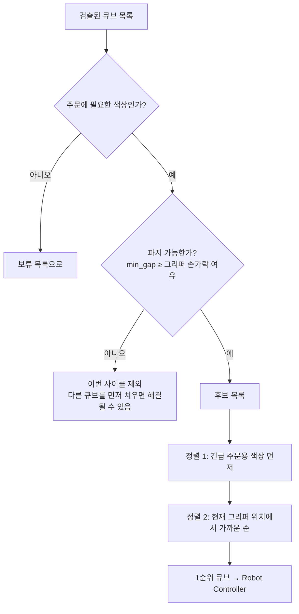
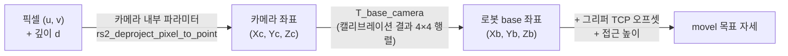
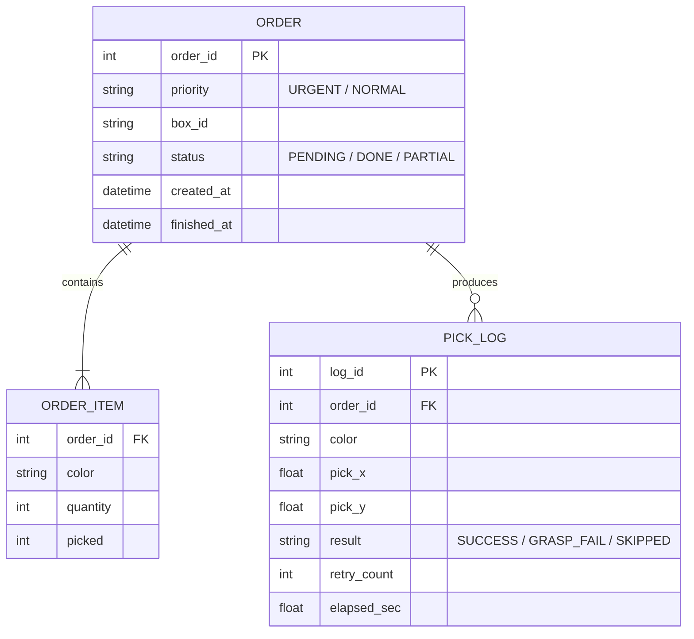

# 🔀 데이터 흐름도 및 시스템 구조

> GitHub와 Notion 모두 ` ```mermaid ` 코드 블록을 다이어그램으로 렌더링합니다.
> (Notion: `/code` 블록을 만들고 언어를 **Mermaid**로 선택한 뒤 붙여넣기)

---

## 1. 시스템 구성도 (하드웨어)



---

## 2. 데이터 흐름도 (DFD)



### 데이터 항목 정의

| 데이터 | 생산자 → 소비자 | 형식 | 주요 필드 |
|---|---|---|---|
| 컬러 + 깊이 영상 | RealSense → Vision | `sensor_msgs/Image` ×2 + `CameraInfo` | 640×480, 깊이는 컬러에 정렬(aligned) |
| 검출 큐브 목록 | Vision → Planner | `DetectedCubeArray` (커스텀) | `color`, `x,y,z` (로봇 base 기준, mm), `yaw` (deg), `confidence`, `min_gap` (mm) |
| 주문 목록 | Order Manager → Planner | `OrderArray` (커스텀) | `order_id`, `priority` (URGENT/NORMAL), `items` {color: 수량}, `box_id`, `status` |
| 피킹 요청 | Planner → Robot | `PickPlace.action` (커스텀) | `pick_pose` (x,y,z,yaw), `place_box_id` |
| 피킹 결과 | Robot → Planner | Action Result | `result` (SUCCESS / GRASP_FAIL / MOTION_ERROR), `elapsed_sec` |

---

## 3. ROS 2 노드 / 토픽 구조



---

## 4. 작업 흐름 (상태 머신)



---

## 5. 우선순위 결정 로직



```python
# task_planner 핵심 로직 (의사코드)
def select_next(cubes, orders, gripper_xy):
    candidates = []
    for c in cubes:
        order = find_open_order_needing(orders, c.color)   # 긴급 주문부터 탐색
        if order is None:
            continue                       # 주문에 없는 색 → 보류
        if c.min_gap < FINGER_CLEARANCE_MM:
            continue                       # 손가락이 들어갈 틈 없음
        dist = hypot(c.x - gripper_xy[0], c.y - gripper_xy[1])
        candidates.append((order.priority_rank, dist, c, order))
    if not candidates:
        return None
    candidates.sort(key=lambda t: (t[0], t[1]))   # 긴급도 → 거리
    return candidates[0]
```

---

## 6. 좌표 변환 흐름



---

## 7. (선택) 작업 로그 ERD

노션 템플릿에 ERD 항목이 있어서, 결과 리포트를 SQLite나 CSV로 남길 경우를 위한 구조입니다. 시간이 부족하면 CSV 파일 하나로 대체해도 됩니다.


